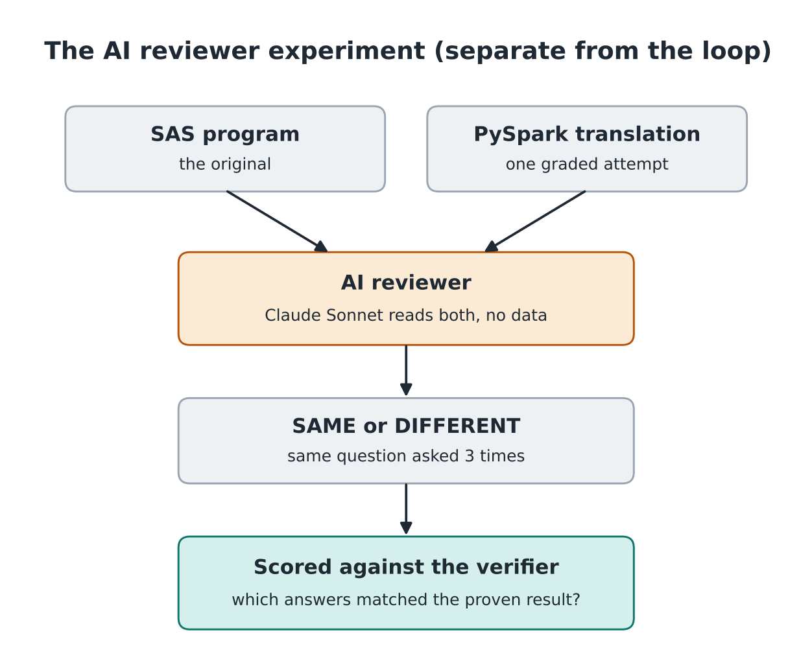
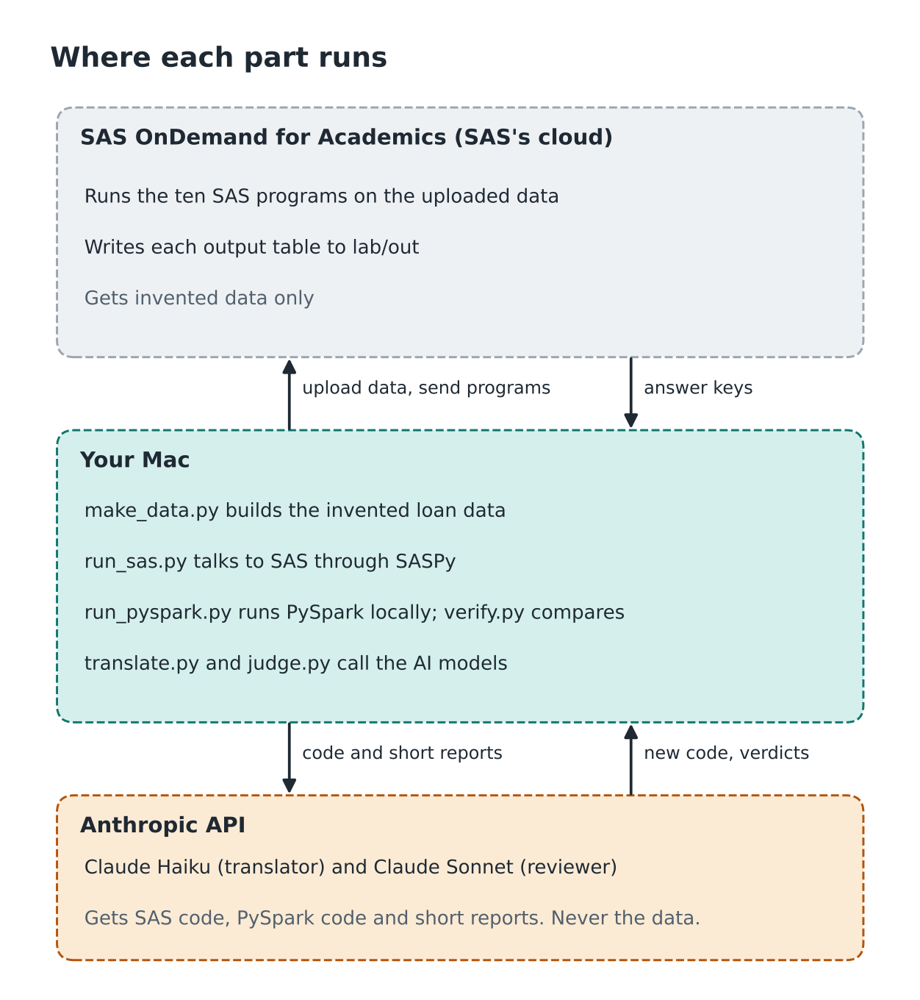

# SAS migration verifier

A home lab that has a small AI model translate SAS programs into PySpark, proves each translation against real SAS output, and then measures how well an AI reviewer would have done the same job by reading the code.

## Start here

| You are | Read | Time |
|---|---|---|
| A leader deciding how to check an AI-assisted SAS migration | [Summary for leaders](#summary-for-leaders), [Results](#results), [Lessons](#lessons) | 5 minutes |
| New to SAS, PySpark or AI agents | [How it works](#how-it-works), [Glossary](#glossary) | 10 minutes |
| An engineer reviewing the design | [How it works](#how-it-works), [Where each step lives](#where-each-step-lives), [Risks and protections](#risks-and-protections), [From laptop to production](#from-laptop-to-production) | 15 minutes |
| Someone who wants to run it | [Setup on a new machine](#setup-on-a-new-machine), [Picking it back up after a break](#picking-it-back-up-after-a-break), [Troubleshooting](#troubleshooting) | 60 minutes |

## Summary for leaders

Claude Haiku translated ten SAS programs into PySpark. A plain Python check, the verifier, ran SAS and PySpark on the same data and compared their output tables. With the verifier's short reports, Haiku got all ten to match SAS, and every one also matched on a copy of the data it never saw.

A stronger model, Claude Sonnet, then read each translation without data and said whether it matched SAS. It approved two first drafts the verifier had already failed, giving the same wrong answer on all three asks. Both kept trailing spaces in product names, and Haiku fixed both on its next try. Sonnet also flagged a translation the verifier had passed, and it was right: the test data had no hyphenated branch names, and SAS capitalizes WINSTON-SALEM as Winston-Salem while Spark's `initcap` gives Winston-salem.

I fixed that difference once, in `sas_compat.py`, a small library of PySpark functions that follow SAS's rules. The translator is told to use it, Spark's `initcap` is blocked, and the edge data with hyphenated names is now part of the check. Haiku's new p04 passed practice, edge and hidden data on its second try.

Use an AI reviewer to find the inputs your test data is missing. Fix each SAS-versus-Spark difference once, in a shared library. Use a check that runs both programs and compares output to decide what ships. Keep SAS running until that check passes.

## How it works


Haiku writes the PySpark. The runner runs it on the practice data, plus the edge data when SAS has made an answer key for it. The verifier compares the output with the table real SAS produced. A failure sends Haiku a short report with at most five example rows, and it tries again. A pass is followed by one run on the hidden copy, which Haiku never sees.



After the loop, a separate experiment gives each graded attempt to Claude Sonnet with no data and scores its SAME or DIFFERENT answers against what the verifier proved.

## Where it runs



The diagrams are drawn by `docs/make_readme_figs.py`. To change one, edit that file and run `python docs/make_readme_figs.py` from the repo root.

## Results

| Attempts Haiku needed | Programs | What the first draft got wrong |
|---|---|---|
| 1 | p01, p02, p03, p06, p08 | Nothing |
| 2 | p04 | One branch total off by one cent |
| 2 | p05 | Half-cent amounts rounded down where SAS rounded up |
| 2 | p07, p10 | Kept trailing spaces in product names |
| 3 | p09 | Used Spark's percentile rule, which differs from SAS's default |

| AI reviewer, 16 graded cases, 3 asks each | Count |
|---|---|
| Wrong code the reviewer approved every time | 2 (p07, p10 first drafts) |
| Wrong code where the reviewer changed its answer | 1 (p09 first draft) |
| Code the verifier passed that the reviewer correctly flagged | 1 (p04 second draft, proven with edge-case data) |
| Right code the reviewer rejected at least once | 1 (p05 second draft, 1 of 3 asks) |

| p04 rerun with SAS-style `propcase` | Result |
|---|---|
| Old p04 (Spark `initcap`) on edge data | FAIL, 4 of 10 branch rows differ |
| New p04, attempt 1 | FAIL on practice data: Pittsburgh total off by one cent |
| New p04, attempt 2 | PASS on practice and edge data |
| New p04, hidden copy | PASS |

## Where each step lives

| Step | File |
|---|---|
| Build practice and hidden data (1k, 100k, 1m loans) | `make_data.py` |
| Build edge-case data with hyphenated branch names | `make_edge_data.py` |
| PySpark functions that follow SAS's rules, such as `propcase` | `sas_compat.py` |
| The ten SAS programs and the folder setup | `sas/` |
| Connect to SAS OnDemand | `sascfg_personal.py` |
| Upload data, run SAS, download answer keys | `run_sas.py` |
| SAS answer keys | `answer_key/` |
| Compare an output table with its answer key | `verify.py` |
| Test the verifier against known-broken copies | `test_verifier.py` |
| Run a PySpark translation and verify it | `run_pyspark.py` |
| Hand-written reference translations | `translations/reference/` |
| Draw the README diagrams | `docs/make_readme_figs.py` |
| Translator loop with Claude Haiku | `translate.py` |
| Every translation attempt Haiku made | `translations/agent/` |
| AI reviewer experiment | `judge.py` |
| Logs of every attempt and every reviewer answer | `logs/attempts.jsonl`, `logs/judge.jsonl` |

## Lessons

### AI-specific

| Category | Lesson | What happened | What I changed |
|---|---|---|---|
| Deterministic vs. probabilistic | Use a deterministic check as the gate and the AI reviewer as advice | The verifier gave the same verdict on every rerun. The reviewer changed its answer on 2 of 16 cases | The verifier decides PASS or FAIL. The reviewer's output only adds test cases |
| Hallucination | A confident, specific explanation can still be wrong | The reviewer approved p07 and p10 three times each with plausible reasons, and both were wrong | Never accept a reviewer's SAME without an output check |
| Evals | A passing test means the code matched on the data you tested | p04 passed practice and hidden data, then failed on WINSTON-SALEM | Added hyphenated names to the edge data and made the edge data part of the check, so p04 now passes all three copies |
| Evals | Test the check before trusting it | My SAS error check fired on `_ERROR_`, a normal variable in SAS's own export code | `test_verifier.py` runs the verifier against known-broken copies of every answer key |
| Agent limits | A limit set too low looks like the model failing | Two of p09's replies were cut off at 4,000 tokens; the passing reply was 7,615 | Raised the cap to 8,000 and told the model when a reply was cut off |
| Prompt injection and excessive agency | The model's code runs on my machine, so it gets the least access possible | The runner reads and writes all files; model code only receives data and returns a table | Code that opens files, starts processes or uses the network is rejected before it runs |

### Familiar controls

| Category | Lesson | What happened | What I changed |
|---|---|---|---|
| Separation of duties | The code writer cannot edit the code checker | Haiku only returns code as text and never sees `verify.py` | The checker is fixed for the whole run |
| Change management | First make the new code match SAS exactly; change behavior later, on purpose | Spark's `initcap` and SAS's PROPCASE capitalize hyphenated names differently | `sas_compat.py` copies the SAS rule once; the translator must use it and `initcap` is blocked |
| Change management | Every SAS quirk is a business decision | SAS counts blank balances as under $1,000 and cuts branch names at 12 characters | Each quirk goes to the report owner to copy or fix |
| Data protection | The model never sees the data | Failure reports carry at most five example rows | Token use is the same at 1,000 rows or a million |
| Third-party risk | Lab data goes to two outside services | Invented data is uploaded to SAS OnDemand; code and short reports go to Anthropic | Only invented data is used. Production would need vendor review |
| Credentials | Secrets stay out of files | SAS and Anthropic credentials live in macOS Keychain; Anthropic keys expire after 24 hours | `sascfg_personal.py` reads them from environment variables and holds no secrets |

## Risks and protections

| Risk | Protection | Where it sits |
|---|---|---|
| A wrong translation passes | Output compared with SAS on two data copies, plus edge-case data | `verify.py`, `run_pyspark.py`, `make_edge_data.py` |
| The model memorizes the practice answers | Hidden copy run once at the end, never shown to the model | `translate.py` |
| The verifier itself is wrong | Tested against deliberately broken copies before use | `test_verifier.py` |
| Model code reads the answer key or touches the network | Blocked-pattern check before running; runner owns all file access | `translate.py`, `run_pyspark.py` |
| A Spark built-in quietly differs from SAS | `sas_compat.py` functions copy SAS; the Spark version is rejected before it runs | `sas_compat.py`, `translate.py` |
| Runaway spend | At most 5 attempts per program and an output cap per reply | `translate.py` |
| Data sent to the model | Reports limited to 5 example rows | `verify.py` |

## From laptop to production

| In the lab | In production | Who would own the change |
|---|---|---|
| A word filter blocks risky model code | Model code runs in a container with no file or network access | Platform engineering |
| Credentials in macOS Keychain | Service accounts with short-lived credentials from a secrets manager | Platform engineering with Cyber |
| Invented loans with planted problems | Masked production data plus edge values the AI reviewer suggests | Data owners with Data Governance |
| I decide each SAS quirk | The report owner approves each change through change management | Business report owner |
| Logs in JSON files | Attempts, verdicts and reviewer answers kept as evidence for model risk review | Model Risk Management |
| 1,000 loans | Production volume, timed against the batch window | Data engineering |
| SAS OnDemand for Academics | The bank's licensed SAS, kept until every program passes | Technology leadership |

## Setup on a new machine

Requires a Mac with Homebrew, a free SAS OnDemand for Academics account (register as an independent learner at welcome.oda.sas.com) and an Anthropic API key.

Read the [Disclaimer](#disclaimer) before you run anything.

1. Install Java 17, which Spark needs.
   ```
   brew install openjdk@17
   echo 'export JAVA_HOME="$(brew --prefix openjdk@17)"' >> ~/.zshrc
   source ~/.zshrc
   java -version
   ```
   You should see: `openjdk version "17...`

2. Clone the repo and create its Python environment.
   ```
   git clone https://github.com/pavankristipati/sas-migration-verifier.git
   cd sas-migration-verifier
   python3 -m venv .venv
   source .venv/bin/activate
   pip install -r requirements.txt
   ```
   You should see: `(.venv)` at the start of your prompt.

3. Add SAS's encryption files to SASPy. Download the package from support.sas.com/downloads/package.htm?pid=2494, unzip it to `~/Downloads/SAS-ODA-JarFiles`, then:
   ```
   IOM=$(python -c \
     "import saspy, os; print(os.path.dirname(saspy.__file__))")/java/iomclient
   cp ~/Downloads/SAS-ODA-JarFiles/*.jar "$IOM"/
   ```
   You should see: `ls "$IOM"` lists `sas.rutil.jar`, `sas.rutil.nls.jar` and `sastpj.rutil.jar`.

4. Store your logins in Keychain. Each `-w` at the end prompts for the secret.
   ```
   security add-generic-password -a "$USER" -s oda-user -w "your-sas-email"
   security add-generic-password -a "$USER" -s oda-password -w
   security add-generic-password -U -a "$USER" -s anthropic-api-key -w
   ```

5. Check your SAS region. `sascfg_personal.py` is set to US Home Region 2. If your SAS Studio address shows a different server, change `iomhost` to match SAS's SASPy page.

6. Create the lab folders on SAS. In SAS Studio, open a new program, paste `sas/setup_folders.sas` and run it.
   You should see: `NOTE: Lab folders are ready under /home/<your id>/lab`

7. Build the data, upload it and make the answer keys.
   ```
   python make_data.py
   export ODA_USER=$(security find-generic-password -s oda-user -w)
   export ODA_PW=$(security find-generic-password -s oda-password -w)
   python run_sas.py sas/p*.sas --upload
   ```
   You should see: 20 lines ending in `saved answer_key/1k/...`

8. Test the verifier.
   ```
   python test_verifier.py
   ```
   You should see: `Verifier gave 0 wrong verdicts.`

9. Run the translator and the reviewer.
   ```
   export ANTHROPIC_API_KEY=$(security find-generic-password -s anthropic-api-key -w)
   python translate.py sas/p*.sas
   python judge.py
   ```
   You should see: one line per attempt, then a summary from the reviewer.

## Picking it back up after a break

1. `cd ~/code/sas-migration-verifier && source .venv/bin/activate`
2. Create a new Anthropic key in the console (they expire after 24 hours) and store it: `security add-generic-password -U -a "$USER" -s anthropic-api-key -w`
3. Load all three secrets into the Terminal window:
   ```
   export ODA_USER=$(security find-generic-password -s oda-user -w)
   export ODA_PW=$(security find-generic-password -s oda-password -w)
   export ANTHROPIC_API_KEY=$(security find-generic-password -s anthropic-api-key -w)
   ```
4. Check the connections: `python run_sas.py --test` should print `Connected as u...`, and `python run_pyspark.py translations/reference/p01.py` should print `PASS`.

## Troubleshooting

| What you see | Cause | Fix |
|---|---|---|
| `An exception was thrown during the encryption key exchange` | SASPy is missing SAS's three encryption jars | Setup step 3 |
| `SAS reported an error` but the log shows `records created` | An early version of `run_sas.py` matched `_ERROR_` in SAS's export code | Use the current `run_sas.py`, which only counts lines starting with `ERROR` |
| `ModuleNotFoundError: No module named 'verify'` | `verify.py` is not in the project folder | Move it from Downloads into the project |
| `401 ... invalid x-api-key` | The Anthropic key expired | Picking it back up, step 2 |
| `module 'translation' has no attribute 'run'` | The model's reply was cut off before the code ended | Use the current `translate.py`, which allows 8,000 tokens and tells the model when it was cut off |
| Reviewer answers show `UNREADABLE` | An early `judge.py` could not find the verdict inside the reviewer's reasoning | Use the current `judge.py` |
| `PySpark does not yet fully support pandas >= 3.0.0` | pandas 3 is installed | `pip install -r requirements.txt` (it pins pandas below 3) |
| `PyArrow >= 18.0.0 must be installed` | pyarrow is missing; Spark falls back to a slower path | `pip install -r requirements.txt` |
| `WARN Utils: Your hostname ... resolves to a loopback address` | Normal on a Mac | Safe to ignore |
| No SAS OnDemand login yet | Registration is approved by email | Check spam and wait for the welcome email |

## Glossary

| Term | Plain meaning |
|---|---|
| SAS | Statistics software banks use for models and regulatory reports |
| PySpark | Python code that runs on Apache Spark, the engine behind Databricks and similar platforms |
| SAS OnDemand for Academics | Free SAS in the browser for learners |
| SASPy | SAS's Python package for running SAS from Python |
| Answer key | The output table SAS produced, treated as correct |
| Practice copy | Data the translator is checked against while it works |
| Hidden copy | Data the translator never sees, used once at the end |
| Edge copy | Practice data with unusual branch names added to test the reviewer's claim |
| Verifier | A plain program that compares an output table with its answer key |
| AI reviewer | A second AI model that reads both programs and gives an opinion |
| Deterministic | Same input always gives the same answer |
| Probabilistic | The same input can give different answers |
| Harness | The scripts around a model that feed it work and check its output |
| Like-for-like migration | Moving code so the new system gives exactly the old system's output, before anything is improved |
| Compatibility function | A small function in the new system that copies a rule from the old one, such as `propcase` in `sas_compat.py` |

## Not yet done

- Final correctness check at 100,000 loans against SAS
- Speed test at 1,000,000 loans on the Mac and on Databricks Free Edition
- Broader edge-case data for the other nine programs, such as rates exactly on a tier boundary
- More compatibility functions in `sas_compat.py` for other SAS-versus-Spark differences (rounding, percentiles, blank-value comparisons, INTCK), each proven against SAS output

## Disclaimer

This is a personal learning project, built on my own time with invented data. It is not affiliated with or endorsed by any employer.

The code is provided as is, with no warranty of any kind. I am not responsible for any damage, data loss, or cost that comes from running it. Read the code before you run it and use invented or test data only. Do not point it at real customer data or at production systems.

Model calls are billed to your own Anthropic account, so watch your API spend.
